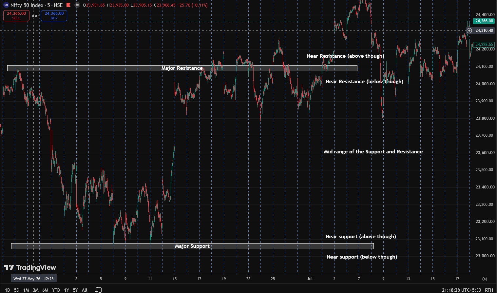

we are thinking to create Nifty 50 Predictor ... ...
How we are going to follow the learning of Ayush Thakur ... 

First we need to know the overview 
- Buying over kaise hoga?
    - Agar price is breaking major resistance level
    - confusion what if we are near the resistance??? it can go reverse 

- Selling overview ??? jab price major support level ko break kar de...

Agar beech mai hai tab?? 
like this 
- yaar lagta hai complex hai ab jab yeh new major break ho jayega phir?? ab new nahi banege ab phir?

---

ab toh yeh baat hogai ki hum kaise figure out karenge over view which we have not yet fully created this system yet for the overview.

but now...
some how we do figure it out let's do some research 

---
ekk theory joh maine banai hai abhi is that
we mark the latest swing high and low on daily chart okay
now what we do it top to bottom we mark the fib with label of 33% 66% okay now what happens is that 
two cases
1- price is in between the top zone part of fib we are still bullish and above it too
2- price is going to up so at the bottom box we are bearish for on after each buying swing we trade selling trade but when it leaves the bottom box we are bullish we keep on taking bullish trade.
we are using swing high/low support resistance by darkakssc

---
some how we do figured it out that .. it was buying or selling overview

now 
for buying overview:
two things can happen 
- first selling swing
    - first selling swing ke baad we can't just directly buy we have to wait for again a buying then selling aur jab is selling swing ko 70% recover or other strength sign then we buy it...
- first buying swing to ab then we wait for selling swing and aggressive

now for selling swing it will be like
- first buying phir selling ka wait then again buying aur ab yeh agreesive entry when signs
- first selling so we wait for a buying then we do agrresive 