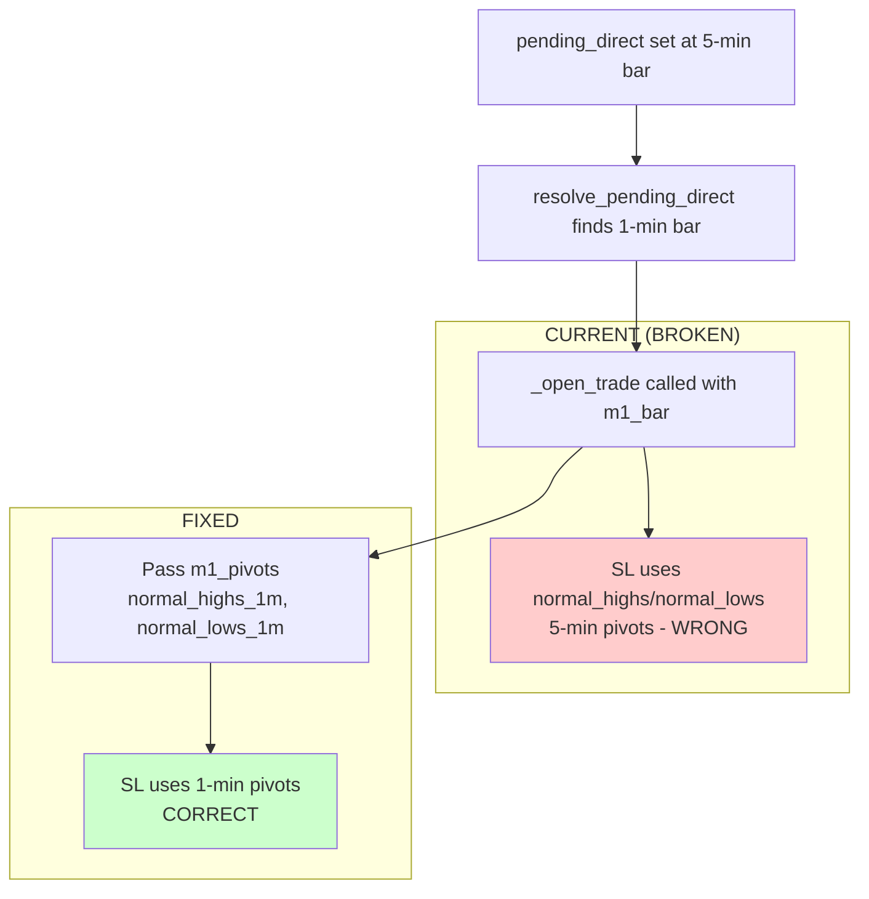

# SL Fix: 1-Min Pivot Break Entries Using Wrong Pivot Reference

**Date:** 2026-08-31
**Issue:** For 1min execution with pivot_break entry method, SL is calculated using 5-min pivots instead of 1-min pivots

---

## Problem Analysis

### Current Flow

1. **Entry Detection (CORRECT):** Uses 1-min WalkerEngine (`walker_1m`) with `normal_highs_1m`/`normal_lows_1m` - finer-grained pivots
2. **SL Calculation (WRONG):** Uses 5-min WalkerEngine (`walker`) with `normal_highs`/`normal_lows` - coarser pivots

### The Bug Location

In [`_open_trade()`](backend/src/intraday.py:637) at line 681:

```python
opposing_pool = normal_lows if dirn == 1 else normal_highs
```

This always uses the 5-min pivots, even when `m1_bar` is provided (1-min mode).

### User's Rule

- Entry at pivot break
- SL at pivot/ECL ± 1pt
- For a SHORT on 28 Aug, SL should be: **high of 9:34 candle** (1-min pivot reference)
- But currently it's using the 5-min pivot reference instead

---

## Root Cause

The `_open_trade` function receives `m1_bar` (the 1-min entry candle), but the SL calculation at line 681 still references `normal_lows`/`normal_highs` (5-min pivots) instead of `normal_lows_1m`/`normal_highs_1m` (1-min pivots).

The `pending_direct` dict passed to `_open_trade` contains:

- `bar_idx`: 5-min bar index
- `trade_dir`: direction
- `level`: the pivot level that was broken (from 1-min walker)
- `break_type`: "pivot_break"
- `armed_ts`: timestamp

But there's no information about **which 1-min pivot** should be used for SL.

---

## Solution Options

### Option A: Pass 1-Min Pivots to `_open_trade` (RECOMMENDED)

Modify `_open_trade` to accept optional 1-min pivot pools and use them when available.

```python
def _open_trade(
    bar_idx: int, dirn: int, ref_level: float, dbar: dict, btype: str,
    m1_bar: dict | None = None,
    m1_pivots: tuple[list, list] | None = None,  # NEW: (normal_highs_1m, normal_lows_1m)
) -> bool:
```

When `m1_bar is not None` and `m1_pivots is not None`:

- Use `m1_pivots[0]` (normal_highs_1m) for SHORT SL
- Use `m1_pivots[1]` (normal_lows_1m) for LONG SL

### Option B: Store Pivot Reference in `pending_direct`

Store the 1-min pivot reference directly in `pending_direct` when setting it up.

```python
pending_direct = {
    "bar_idx": i,
    "trade_dir": trade_dir,
    "level": brk["level"],
    "break_type": brk["type"],
    "armed_ts": int(cur["ts"]),
    "sl_pivot": piv.px,  # NEW: the pivot to use for SL
    "sl_pivot_idx": piv.idx,  # NEW: pivot index for reference
}
```

Then use this in `_open_trade`.

---

## Implementation Plan

### Step 1: Modify `_open_trade` Signature

Add optional `m1_pivots` parameter.

### Step 2: Update SL Calculation in `_open_trade`

When `m1_bar is not None` and `m1_pivots is not None`:

- Use 1-min pivots for SL calculation
- For SHORT: SL = most recent H-pivot + buffer
- For LONG: SL = most recent L-pivot - buffer

### Step 3: Pass 1-Min Pivots at Call Sites

When calling `_open_trade` from 1-min context, pass the 1-min pivot pools.

### Step 4: Update Breached Check

The breached check at lines 689-692 should also use the 1-min entry candle (which it already does via `entry_candle_low`/`entry_candle_high`).

### Step 5: Verify on 28 Aug

- Run the backtest and check that SL = high of 9:34 candle for the first trade

---

## Code Changes Required

### File: `backend/src/intraday.py`

1. **Line 637-639**: Update function signature

```python
def _open_trade(
    bar_idx: int, dirn: int, ref_level: float, dbar: dict, btype: str,
    m1_bar: dict | None = None,
    m1_pivots: tuple[list, list] | None = None,
) -> bool:
```

2. **Line 681**: Use 1-min pivots when available

```python
if m1_bar is not None and m1_pivots is not None:
    opposing_pool = m1_pivots[0] if dirn == 1 else m1_pivots[1]
else:
    opposing_pool = normal_lows if dirn == 1 else normal_highs
```

3. **Line 1073-1080**: Pass 1-min pivots when calling `_open_trade`

```python
if _open_trade(
    pending_direct["bar_idx"],
    pending_direct["trade_dir"],
    pending_direct["level"],
    candles[pending_direct["bar_idx"]],
    pending_direct["break_type"],
    m1_bar=m1_bar,
    m1_pivots=(normal_highs_1m, normal_lows_1m),
):
```

---

## Mermaid Diagram: Current vs Fixed Flow



---

## Testing Checklist

- [ ] Run backtest on 28 Aug with 1min execution
- [ ] Verify first trade entry is correct (pivot break detected)
- [ ] Verify SL is set to high of 9:34 candle (1-min reference)
- [ ] Run full backtest to ensure no regression on other days
- [ ] Verify 5-min mode still works correctly (no change expected)

---

## Risk Assessment

- **Low Risk:** The fix only affects SL calculation in 1-min mode
- **5-min mode:** Unaffected (uses different code path)
- **Backward compatible:** Optional parameter with default behavior preserved
