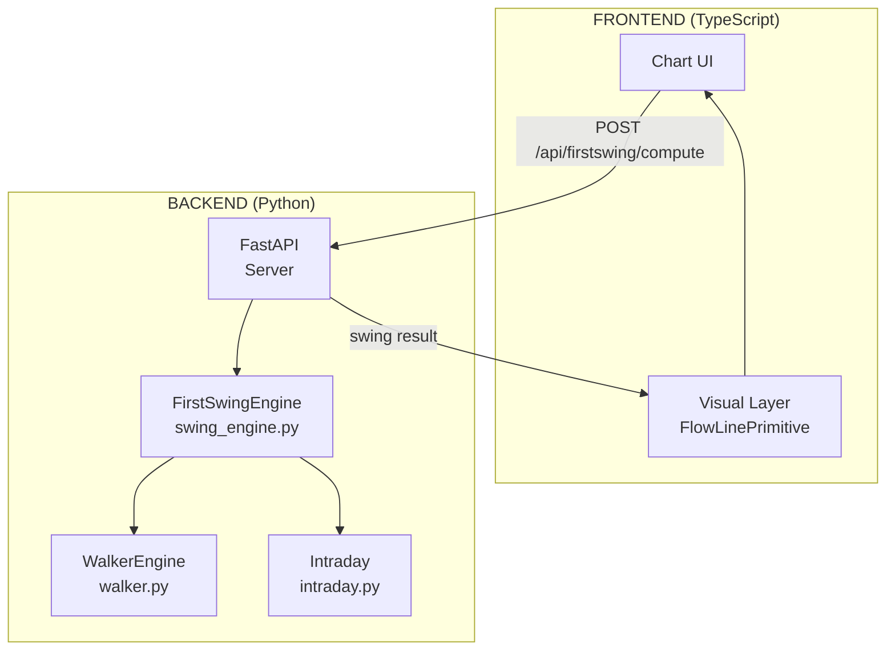

# Swing Engine Port: Frontend → Backend

## Objective

Port the advanced swing detection logic from frontend (`firstswing.ts`, `flowline.ts`) to Python backend, replacing the simple time-based `_classify_first_swing()` with full price-action detection.

---

## Architecture Overview



---

## Components to Port

### 1. WalkerEngine (`walker.py`)

**Source:** `frontend/src/lib/flowline.ts` lines 76-442

**Responsibilities:**

- Color-aware candle path follower
- Tracks pivots with sealed/pending states
- Handles inside candles with "onion rule" (nested insulators)
- Two-step processing: low-first (green) or high-first (red)

**Key Python class:**

```python
class WalkerEngine:
    """Port of WalkerEngine from flowline.ts."""

    def __init__(self):
        self.k = -1
        self.dir: Literal["up", "down"] = "up"
        self.stamp_idx = -1
        self.stamp_k = -1
        self.stamp_t = ""
        self.stamp_px = float('nan')
        self.prev_high = float('nan')
        self.prev_low = float('nan')
        self.band_low: float | None = None
        self.band_high: float | None = None
        self.pending: WPending | None = None
        self.hi_px: float | None = None
        self.hi_idx = -1
        self.lo_px: float | None = None
        self.lo_idx = -1
        self.bar_out: list[AlgoPivot] = []

    def process_bar(self, c: FlowCandle, g_idx: int) -> list[AlgoPivot]:
        """Process one closed bar. Returns sealed pivots from this bar."""
        ...

    def finalize(self) -> AlgoPivot | None:
        """Return trailing open swing when day ends."""
        ...

@dataclass
class AlgoPivot:
    idx: int
    time: str
    kind: Literal["H", "L"]
    px: float
    sealed: bool

@dataclass
class FlowCandle:
    date: str      # ISO datetime
    open: float
    high: float
    low: float
    close: float
```

**Critical logic to port:**

- Bar step order: green → [low, high], red → [high, low]
- Stamp tracking: same-direction extends SHIFT stamp, opposite-direction breaks SEAL
- Pending resolution: confirm (near breaks) vs skip (far breaks) vs volatile (both)
- Onion rule: nested insulators absorb into stack

---

### 2. FirstSwingEngine (`swing_engine.py`)

**Source:** `frontend/src/lib/firstswing.ts` lines 59-527

**Responsibilities:**

- Full first-swing detection using Walker pivot stream
- Continuation: extends same extreme TWICE in a row
- Reversal: breaks one extreme, then OTHER original extreme
- 9:29 rule (nothing declares before 9:29)
- Chop-back or 7-bar sustain confirmation
- Corner pivot tracking for B2

**Key Python class:**

```python
class FirstSwingEngine:
    """Port of FirstSwingEngine from firstswing.ts."""

    # Tunables
    time_cap = "09:29"       # nothing declares before
    sustain_bars = 7         # N-bar sustain requirement

    def __init__(self, opts: dict | None = None):
        self.walker = WalkerEngine()
        self.bars_seen = 0
        self.state: Literal["watch", "locked", "confirmed"] = "watch"
        self.dir: Literal["up", "down"] | None = None
        self.base_dir: Literal["up", "down"] | None = None
        self.same_side_breaks = 0
        self.dir_confirmed = False
        self.locked_level = float('nan')
        # Session extremes (living A/B)
        self.e_hi = Lvl(px=-inf, idx=-1, time="")
        self.e_lo = Lvl(px=inf, idx=-1, time="")
        self.e_hi_prev = Lvl(px=-inf, idx=-1, time="")
        self.e_lo_prev = Lvl(px=inf, idx=-1, time="")
        # Walker sealed pivots - NOT what B2/FLIP target (that is e_hi_prev / e_lo_prev)
        self.e_hi_pivot: Lvl | None = None
        self.e_lo_pivot: Lvl | None = None
        self.normal_highs: list[Lvl] = []
        self.normal_lows: list[Lvl] = []
        # Corner tracking
        self.corner_pivot: Lvl | None = None
        self.b2_pivot: Lvl | None = None
        self.b1_bar_idx = -1
        self.allow_corner_record = False
        self.just_fired_b2 = False
        # Sustain tracking
        self.sustain_streak = 0
        self.armed = False
        # Output
        self.declared = False
        self.tier: Literal["real"] | None = None
        self.start_idx = -1
        self.start_time = ""
        self.start_px = float('nan')
        self.end_idx = -1
        self.end_time = ""
        self.end_px = float('nan')
        self.confirmed_at_idx = -1
        self.confirmed_at_time = ""
        self.confirm_source: Literal["chop", "sustain"] | None = None
        self.break_marks: list[FsBreakMark] = []
        self.cand_idx = -1
        self.cand_time = ""
        self.cand_px = float('nan')

    def process_bar(self, c: FlowCandle, g_idx: int) -> None:
        """Feed one closed bar. State machine updates in-place."""
        ...

    def get_result(self) -> FsV2Result | None:
        """Return structured result if declared, else None."""
        ...
```

**Detection Rules (from docs):**

1. **Continuation:** Session extreme extends TWICE in a row (fresh extremes, not re-breaking same level)
   - Lock fires on first break (B1)
   - B2 fires when price breaks the corner pivot OR the B1 extreme from a later bar

2. **Reversal:** One extreme breaks, then the OTHER ORIGINAL extreme breaks
   - Exactly ONE break needed for reversal
   - Immediately flips direction + dirConfirmed

3. **Confirmation (after direction locked):**
   - **Chop:** Price reclaims the most recent marked pivot
   - **Sustain:** 7 closes back through the broken level (failure-to-extend)
   - Fresh extreme resets sustain streak

4. **9:29 Rule:** Nothing DECLARES before 9:29 (pre-cap triggers are held pending)

5. **Arming Gate:** No lock/flip fires before the first walker pivot exists (prevents noise)

---

### 3. API Endpoint

**New endpoint:** `POST /api/firstswing/compute`

```python
from pydantic import BaseModel

class FlowCandleInput(BaseModel):
    date: str      # "2025-08-28T09:15:00"
    open: float
    high: float
    low: float
    close: float

class FsBreakMark(BaseModel):
    idx: int
    time: str
    kind: Literal["B1", "B2", "FLIP"]
    dir: Literal["up", "down"]
    px: float

class FsV2Result(BaseModel):
    day: str
    outcome: Literal["real"]
    conf_idx: int
    seg: FlowSegment
    source: Literal["chop", "sustain"] | None
    dir: Literal["up", "down"]
    breaks: list[FsBreakMark]

class FlowSegment(BaseModel):
    dir: Literal["B", "S"]
    start_idx: int
    start_px: float
    end_idx: int
    end_px: float

@app.post("/api/firstswing/compute")
def compute_first_swing(candles: list[FlowCandleInput]) -> list[FsV2Result]:
    """Run first-swing detection on provided candles.

    Candles should be sorted by date, globally across all days.
    Results are per-day with one entry per day that has a declared swing.
    """
```

---

### 4. Integration with Intraday.py

**Current code to replace (lines 175-222):**

```python
# OLD: Simple time-based first swing
def _classify_first_swing(candles: list[dict]) -> tuple[str | None, int, list[dict]]:
    win = [c for c in candles if c["time"] < OPENING_SETTLE]  # 9:45
    ...
```

**New integration:**

```python
# NEW: Use full swing engine
def _classify_first_swing(candles: list[dict]) -> tuple[str | None, int, list[dict]]:
    # Convert to FlowCandle format
    flow_candles = [
        FlowCandle(
            date=c["ts"],  # or proper ISO format
            open=c["open"],
            high=c["high"],
            low=c["low"],
            close=c["close"]
        )
        for c in candles
    ]

    eng = FirstSwingEngine()
    for i, c in enumerate(flow_candles):
        eng.process_bar(c, i)

    result = eng.get_result()
    if result is None:
        return None, -1, []

    direction = "buying" if result.dir == "up" else "selling"
    return direction, result.seg.start_idx, []
```

**Changes needed:**

1. Add `from src.swing_engine import FirstSwingEngine, FlowCandle` to intraday.py
2. Replace `_classify_first_swing()` implementation
3. Update return format handling (new engine returns `FsV2Result`)
4. Update `result["swing_direction"]` assignment

---

## File Structure

```
backend/src/
├── __init__.py
├── walker.py          # NEW: WalkerEngine port
├── swing_engine.py    # NEW: FirstSwingEngine port
├── firstswing.py      # NEW: alias for swing_engine (matches frontend naming)
├── intraday.py        # MODIFIED: use new engine
├── ...
```

---

## Data Format Mapping

| Frontend (TypeScript) | Backend (Python)        |
| --------------------- | ----------------------- |
| `FlowCandle`          | `FlowCandle` dataclass  |
| `AlgoPivot`           | `AlgoPivot` dataclass   |
| `FsV2Result`          | `FsV2Result` dataclass  |
| `FsBreakMark`         | `FsBreakMark` dataclass |
| `Lvl`                 | `Lvl` dataclass         |

---

## Testing Strategy

1. **Unit tests** for WalkerEngine (compare against frontend behavior)
2. **Unit tests** for FirstSwingEngine (known cases from docs)
3. **Integration tests** with existing intraday backtest
4. **Visual diff** between frontend and backend results on same data

---

## Implementation Order

1. [ ] Create `walker.py` with WalkerEngine
2. [ ] Create `swing_engine.py` with FirstSwingEngine
3. [ ] Add `POST /api/firstswing/compute` endpoint
4. [ ] Update `intraday.py` to use new engine
5. [ ] Add unit tests for both engines
6. [ ] Verify frontend/backend results match
7. [ ] Update docs if needed

---

## Risk Assessment

| Risk                                 | Mitigation                                         |
| ------------------------------------ | -------------------------------------------------- |
| Floating-point precision differences | Compare with tolerance, document rounding behavior |
| Timestamp format differences         | Explicit ISO format conversion at API boundary     |
| State machine edge cases             | Match test cases from frontend's FLOW_COV coverage |
| Performance (Python vs TS)           | Profile, consider numba/cython if needed           |
